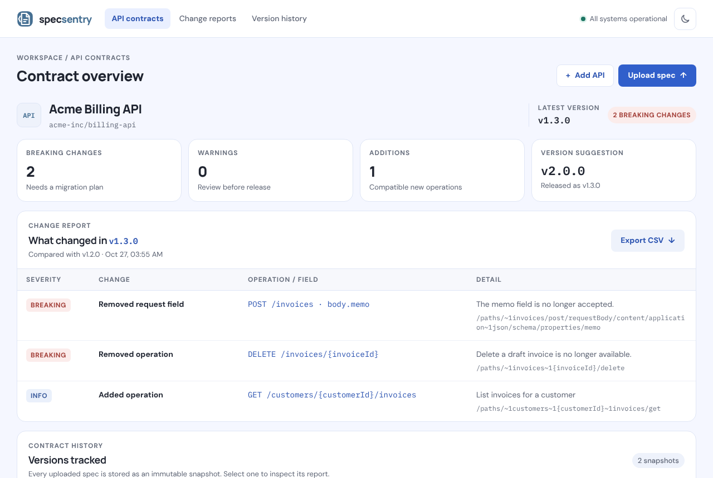

# SpecSentry

SpecSentry compares OpenAPI 3 JSON snapshots and flags the changes that can break existing API consumers, before a release ships.

It comes as a single Rust binary with two jobs:

- **`specsentry check`**: a CI gate. It compares a baseline and a candidate document and exits non-zero when it finds breaking changes.
- **`specsentry serve`**: a small web app and JSON API. It keeps an immutable history of contract snapshots per API, shows a change report for each upload and suggests the next semantic version.



## What it detects

Each finding has a stable **rule id**, a **severity**, a human-readable message and an [RFC 6901](https://www.rfc-editor.org/rfc/rfc6901) **JSON pointer** to the affected location. The pointer refers to the base document for removals and to the candidate otherwise. When a schema comes from a `$ref`, the pointer names the referenced component, such as `/components/schemas/Invoice/properties/memo`.

| Rule id | Severity | Triggered when |
| --- | --- | --- |
| `path-removed` | breaking | A path and all its operations disappear |
| `operation-removed` | breaking | A method is removed from a path that still exists |
| `operation-added` | info | A new operation appears (counted as an addition) |
| `operation-deprecated` | info | An operation becomes `deprecated: true` |
| `parameter-removed` | breaking | A path, query, header or cookie parameter is removed |
| `parameter-added-required` | breaking | A new required parameter is introduced |
| `parameter-added-optional` | info | A new optional parameter is introduced |
| `parameter-became-required` | breaking | An optional parameter becomes required |
| `parameter-type-changed` | breaking | A parameter type no longer accepts the old values (for example `string` → `integer`) |
| `parameter-enum-reduced` | breaking | Values are removed from, or an enum is added to, a parameter |
| `request-body-added-required` | breaking | An operation without a body now requires one |
| `request-body-became-required` | breaking | An optional request body becomes required |
| `request-media-type-removed` | breaking | A request content type is no longer accepted |
| `request-field-added-required` | breaking | A new required field appears in a request schema |
| `request-field-became-required` | breaking | An existing optional request field becomes required |
| `request-field-removed` | breaking | A request field is removed |
| `request-type-changed` | breaking | A request field type no longer accepts the old values |
| `request-enum-reduced` | breaking | A request enum loses values or gains a restriction |
| `response-success-removed` | breaking | A `2xx` response code is removed |
| `response-removed` | warning | A non-`2xx` response code (or `default`) is removed |
| `response-media-type-removed` | breaking | A response content type is no longer returned |
| `response-field-removed` | breaking | A response field is removed |
| `response-field-became-optional` | warning | A required response field may now be missing |
| `response-type-changed` | breaking | A response field may now return a type clients have not seen before (including newly `nullable`) |
| `response-enum-expanded` | warning | A response enum gains values or loses its constraint |
| `ref-unresolved` | warning | A `$ref` is external, missing or circular and could not be followed |

How the comparison works:

- **Request and response direction.** Requests compare *what the server accepts*, so widening is safe (`integer` → `number`, adding enum values). Responses compare *what clients must handle*, so narrowing is safe and widening is flagged.
- **`$ref` resolution.** Local refs (`#/components/...`, including `~0`/`~1` and percent escapes) are followed for path items, parameters, request bodies, responses and schemas. Ref chains that point back at themselves are reported, and recursive schemas such as trees are compared once per schema pair, so the comparison always finishes. `allOf` members are merged before comparison.
- **Stable matching.** Paths are matched by template shape (`/items/{id}` equals `/items/{itemId}`), path parameters by position, header names and HTTP methods case-insensitively, and status codes case-insensitively (`2XX` equals `2xx`). Parameters defined on the path item are inherited by its operations.
- **Version suggestion.** Breaking changes suggest a major bump, any other finding a minor bump, and no findings a patch bump.

## CLI

```bash
cargo build --release
./target/release/specsentry check openapi/base.json openapi/candidate.json
```

```
INFO      GET /status  A new operation is available.  [operation-added /paths/~1status/get]
No breaking contract changes detected.
Summary: 0 breaking, 0 warning, 1 info.
```

| Option | Values | Default | Meaning |
| --- | --- | --- | --- |
| `--format` | `text`, `json`, `github` | `text` | `json` prints a machine-readable report on stdout. `github` prints workflow annotations. |
| `--fail-on` | `breaking`, `warning`, `never` | `breaking` | Lowest severity that makes the command fail |

Exit codes: `0` means compatible, `1` means the `--fail-on` threshold was reached, `2` means invalid input (unreadable file, invalid JSON, not an OpenAPI 3 document, or bad arguments).

### In CI

`.github/workflows/contract-check.yml` builds the CLI, writes a JSON report as an artifact and a summary to the job page, and then fails the job on breaking changes with inline annotations:

```yaml
- run: cargo build --release --locked -p specsentry
- run: ./target/release/specsentry check openapi/base.json openapi/candidate.json --format github
```

You can also run the CLI from the container image without a Rust toolchain:

```bash
docker run --rm -v "$PWD/openapi:/specs:ro" specsentry:local check /specs/base.json /specs/candidate.json
```

## Web app and API

Run `specsentry serve` and open <http://localhost:3005>. On first boot an empty database is seeded with a fictional *Acme Billing API* that has two snapshots, so a change report is visible right away. Set `SEED_DEMO=false` to turn this off.

The UI lets you connect APIs, upload snapshots (pasted or loaded from a file), browse version history, inspect each report with rule ids and JSON pointers, and export it as CSV. It works in light and dark mode, either following the OS or chosen manually, and down to 390 px wide.

| Method and path | Description | Success | Errors |
| --- | --- | --- | --- |
| `GET /api/health` | Liveness check that includes the database. Returns `{ ok, version, database }` | 200 | 503 |
| `GET /api/projects` | Lists projects with their latest snapshot | 200 | |
| `POST /api/projects` | `{ name, repository?, version?, spec }` creates a project and its baseline. Returns `{ id, name, repository, versionId }` | 201 | 400 |
| `GET /api/projects/:id/versions` | Lists snapshots newest first, with `changeSummary`, counts and `suggestedVersion` | 200 | 404 |
| `GET /api/projects/:id/versions/:versionId/spec` | Returns a stored document as `{ id, version, specJson, spec }` | 200 | 404 |
| `POST /api/projects/:id/specs` | `{ spec, version? }` compares the document with the latest snapshot and stores it. Returns `{ id, version, breakingCount, addedCount, warningCount, changes, suggestedVersion }` | 201 | 400, 404, 409 |

`spec` may be a JSON object or a string containing JSON. When `version` is omitted, the suggested version is used. Errors are always JSON (`{ "error": "..." }`), including malformed bodies (400), wrong content type (415), oversized bodies (413), unknown routes (404) and wrong methods (405). Request bodies must be sent as `application/json`.

## Running it

### With Cargo

Requires Rust 1.85 or newer (stable).

```bash
cargo run -- serve              # http://127.0.0.1:3005
LOG_FORMAT=pretty PORT=8080 cargo run -- serve
cargo test                      # unit, HTTP and CLI tests
```

The binary does not read `.env` files. Export the variables in your shell (`set -a; . ./.env; set +a`) or let Docker Compose load them.

### With Docker

```bash
docker compose up --build       # http://localhost:3005, data in the specsentry-data volume
```

Or without Compose:

```bash
docker build -t specsentry:local .
docker run -d -p 3005:3005 -v specsentry-data:/data specsentry:local
```

The image is multi-stage. Dependencies are compiled in their own cached layer, and the runtime is `gcr.io/distroless/cc-debian12:nonroot`, which has no shell, runs as a non-root user, stores data in a `/data` volume and declares a `HEALTHCHECK` that uses `specsentry healthcheck`.

### Configuration

All settings are environment variables, validated at boot. An invalid value stops startup with a clear error. See `.env.example`.

| Variable | Default | Description |
| --- | --- | --- |
| `BIND_ADDR` | `127.0.0.1` (`0.0.0.0` in the image) | Interface to listen on |
| `PORT` | `3005` | TCP port |
| `DATABASE_PATH` | `data/specsentry.sqlite` (`/data/specsentry.sqlite` in the image) | SQLite file, created along with its directory if missing |
| `PUBLIC_DIR` | `public` (`/app/public` in the image) | Static UI directory. It must contain `index.html` |
| `MAX_BODY_BYTES` | `2097152` | Request body limit, from 1 KiB to 64 MiB |
| `REQUEST_TIMEOUT_SECS` | `15` | Per-request timeout, from 1 to 300 seconds |
| `LOG_FORMAT` | `json` | `json` for structured logs, `pretty` for local development |
| `RUST_LOG` | `info` | Log filter (`tracing` env-filter syntax) |
| `SEED_DEMO` | `true` | Seeds the demo project when the database is empty |

## Project layout

```
crates/
  domain/   specsentry-domain: pure diff engine (rules, $ref resolution, semver). No I/O.
  store/    specsentry-store: SQLite persistence and versioned SQL migrations.
  http/     specsentry-http: axum router, handlers, use cases, middleware.
  cli/      specsentry: the binary (serve, check, healthcheck).
public/     Static web UI (HTML, CSS, JS, self-hosted fonts).
openapi/    Sample contracts used by the contract-check workflow and tests.
docs/       README assets.
.github/    CI, contract check and Dependabot configuration.
```

## Architecture and decisions

```
specsentry (bin) ─┬─ check ───────────────► domain
                  └─ serve ─► http ─┬─────► domain
                                    └─────► store ─► SQLite
```

- **Rust.** One statically checked engine now backs both the CLI and the server. Before, the Node version had two copies of the diff logic that had drifted apart. A single binary of a few MB starts in milliseconds, runs comfortably in a distroless image and handles large specs predictably. The type system also makes the rule catalogue exhaustive: adding a rule forces its severity, title and id to be defined.
- **Pure domain crate.** `specsentry-domain` only turns `serde_json::Value` into a `Report`. It is tested rule by rule without I/O, and the CLI uses it without pulling in the web stack.
- **SQLite with `rusqlite` (bundled).** There is no external database to run. A single connection behind a mutex matches SQLite's single-writer model. Handlers reach it through `spawn_blocking`, so the async runtime is never blocked. Uploading a snapshot reads the baseline and inserts the new one in one `BEGIN IMMEDIATE` transaction, so concurrent uploads cannot compare against a stale baseline.
- **Versioned migrations.** These are SQL files in `crates/store/migrations`, tracked with `PRAGMA user_version`. Migration 1 uses `IF NOT EXISTS`, so databases created by the former Node service are upgraded in place.
- **Unchanged HTTP contract.** Routes, payload shapes, status codes and error messages match the previous service, so existing clients and the UI keep working. New fields were only added (`rule`, `pointer`, `warningCount`, `suggestedVersion`).
- **Middleware (tower-http).** This covers request IDs (`x-request-id`, generated or propagated), structured tracing (path only, never query strings), gzip, a request timeout, a body limit, panic recovery and security headers.

## Production notes

- **Security headers** on every response: a strict `Content-Security-Policy` (same origin only, no inline scripts or styles), `X-Content-Type-Options`, `X-Frame-Options: DENY`, `Referrer-Policy: no-referrer`, `Permissions-Policy` and `Cross-Origin-Opener-Policy`. API responses are `Cache-Control: no-store`. Static files are `no-cache` and revalidated with ETags.
- **TLS and HSTS** belong in the reverse proxy or load balancer in front of the service.
- **Authentication is not built in.** Deploy SpecSentry inside a private network or behind an authenticating proxy (SSO or OAuth2 proxy). Anyone who can reach it can create projects and upload snapshots.
- **Graceful shutdown.** On `SIGTERM` or Ctrl+C the server stops accepting connections and drains in-flight requests, which the request timeout bounds.
- **Backups.** The database runs in WAL mode. Back up `/data` with `sqlite3 specsentry.sqlite ".backup backup.sqlite"` or a volume snapshot.
- **Health checks.** Use `GET /api/health`, which returns 503 when the database is unavailable. Inside the image, run `specsentry healthcheck`.

## Limitations

- Only JSON documents are accepted. YAML and Swagger 2.0 are not supported.
- External `$ref`s (other files or URLs) are not followed. They are reported as `ref-unresolved`.
- `oneOf` and `anyOf` branches, `additionalProperties`, string formats, numeric bounds and patterns are not compared yet. `allOf` is merged.
- Media types are matched exactly (`application/json` and `application/json; charset=utf-8` count as different).
- The analysis is conservative and rule based. It is a strong first review, not a proof of compatibility. Contract tests and consumer feedback are still worth having.
